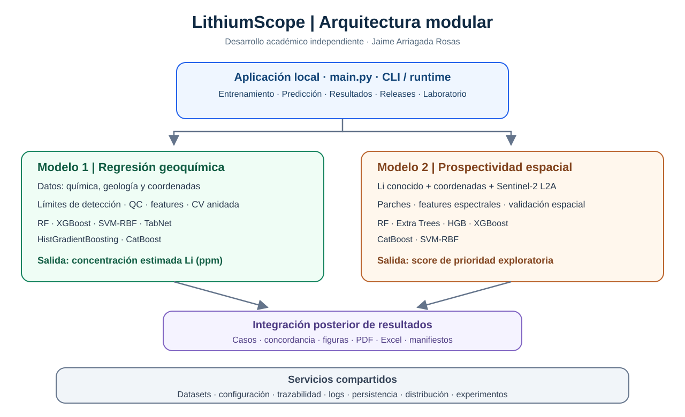
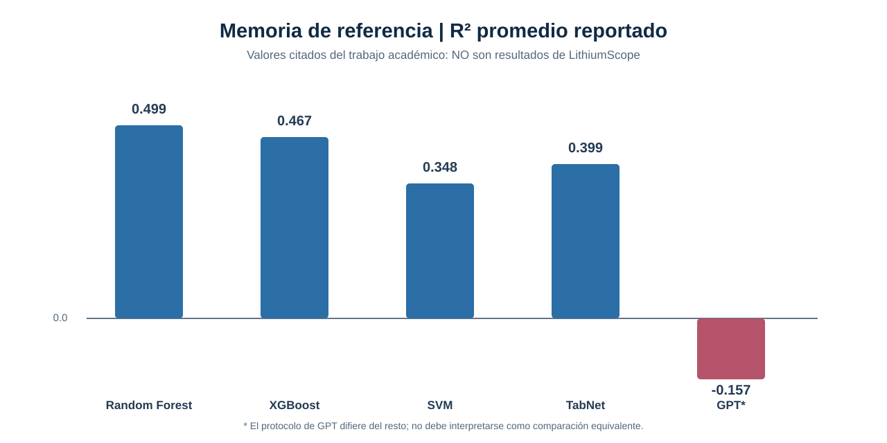

# LithiumScope

**Sistema local de investigación aplicada para estimar concentración de litio y estudiar prospectividad espacial mediante aprendizaje automático.**

**Autor del código:** **Jaime Arriagada Rosas**. LithiumScope es un trabajo académico propio, implementado desde cero. La memoria de otros estudiantes y el **Proyecto Anillo OASIS ATE240015** se utilizan únicamente como *referencia y contexto académico*; **no desarrollaron ni son coautores de este software**. Consulta [autoría y referencias](CREDITS.md).



## Qué hace

LithiumScope es una única aplicación Python, modular y sin servidor obligatorio. Resuelve dos problemas que permanecen científicamente independientes:

| | Modelo 1 (M1) | Modelo 2 (M2) |
|---|---|---|
| Objetivo | Estimar concentración de litio en muestras de roca | Priorizar áreas según características espectrales asociadas a Li conocido |
| Entrada | Geoquímica, geología y datos de la muestra | Parches Sentinel-2 L2A, coordenadas y etiquetas geoquímicas |
| Salida | `Li_icpms` estimado en ppm | Score de prospectividad/prioridad exploratoria |
| Evaluación | RMSE, MAE, R² | ROC-AUC, Average Precision y calibración |

La integración **compara los resultados después de ejecutar cada modelo**, sin incorporar automáticamente las predicciones de M1 como variables de entrenamiento de M2. La prioridad de M2 **no es una probabilidad de encontrar un yacimiento económicamente viable** ni sustituye una validación geológica.

## Instalación

**Requiere Python 3.11 o superior.** Desde un clon del repositorio:

```powershell
git clone https://github.com/JaimeArriagadaRosas/LithiumScope.git
cd LithiumScope
python -m venv .venv
.venv\Scripts\Activate.ps1
python -m pip install --upgrade pip
python -m pip install -e ".[ml,imagery]"
python main.py
```

En Linux/macOS se activa el entorno con `source .venv/bin/activate`. Para desarrollar y ejecutar la suite, se puede instalar `python -m pip install -e ".[ml,imagery,dev]"`.

También están disponibles `lithiumscope` y `lithiumscope-inspect` tras instalar el paquete. En un *wheel* instalado fuera del clon, los recursos predeterminados se incluyen en el paquete y los datos de usuario se almacenan en `~/.lithiumscope/`, salvo que se configure `LITHIUMSCOPE_HOME`. Ver [empaquetado](docs/operations/PACKAGING.md).

## Menú de la aplicación

```text
1. Entrenar modelos
2. Realizar predicción
3. Métricas y resultados
4. Cargar modelo versionado
5. Laboratorio de simulaciones
0. Salir
```

**1. Entrenar modelos.** Ejecuta la competencia de M1, M2 o ambos. Cada familia de problema evalúa seis algoritmos de manera controlada, conserva métricas por fold, selección de hiperparámetros y modelo ganador. La adquisición de datos necesaria se prepara cuando corresponde; abrir el menú no requiere descargar todos los datasets.

**2. Realizar predicción.** Permite usar M1, M2, ambos en una predicción integrada o la **demostración integrada automática de 10 casos**. La demostración produce desde la propia aplicación tablas, figuras, Excel, PDF científico y manifiestos; no es un PDF redactado manualmente.

**3. Métricas y resultados.** Consulta ejecuciones, dashboards, evidencias y posibles candidatos para versión. Evaluar un candidato **no crea un release automáticamente**.

**4. Cargar modelo versionado.** Descarga desde GitHub Releases el asset `-artifacts.zip`, valida estructura e integridad y prepara los modelos para inferencia. No utiliza los archivos automáticos *Source code* de GitHub. Esta opción permite probar modelos publicados sin entrenarlos de nuevo.

**5. Laboratorio de simulaciones.** Ejecuta auditorías, estudios de sensibilidad y experimentos científicos separados de la selección operativa de modelos. Sus resultados **no reemplazan automáticamente** los modelos publicados o activos.

## Métodos y datos

M1 utiliza seis familias: **Random Forest, XGBoost, SVM-RBF, TabNet, HistGradientBoosting y CatBoost**; su validación contempla esquemas anidados, predicciones fuera de fold y baselines. Los pasos incluyen carga, límites de detección, control de faltantes, selección del objetivo, control geoquímico, categorías, ingeniería de variables y preprocesamiento.

M2 compara **Random Forest, Extra Trees, HistGradientBoosting, XGBoost, CatBoost y SVM-RBF**. Sus etiquetas y features deben mantener trazabilidad y respetar la validación espacial agrupada cuando corresponda. El modelo histórico utiliza un esquema de **126 características**; el experimento espectral v4 de **170 características** es una línea de investigación distinta y no debe activarse sin resolver su compatibilidad de inferencia.

Para M1 se utiliza un mirror público de `Mamani09_Table_DR2` mientras no se confirme la fuente oficial de la memoria. **No se presenta como repositorio oficial de OASIS.** Para M2, el sistema puede obtener y almacenar temporalmente parches Sentinel-2 asociados a muestras conocidas; `training_manifest.csv` es un artefacto generado por el pipeline, no un archivo que el usuario deba preparar manualmente.

La memoria académica de referencia informa la siguiente baseline; **no representa resultados medidos por LithiumScope** ni garantiza una comparación bajo el mismo protocolo:

| Algoritmo de referencia | R² medio | RMSE medio (ppm) |
|---|---:|---:|
| Random Forest | 0.499 | 5.361 |
| XGBoost | 0.467 | 5.528 |
| SVM | 0.348 | 6.124 |
| TabNet | 0.399 | 5.828 |
| GPT* | -0.157 | 6.934 |

*GPT fue evaluado con un procedimiento distinto; su cifra no es directamente comparable con las demás.*



## Resultados y reproducibilidad

Cada entrenamiento registra una identidad `run_id`, versión del código, hashes de datos, configuración, entorno, métricas y evidencias. Los modelos se conservan con metadatos y esquema de características. Las salidas locales se organizan principalmente en `models/`, `results/` y `logs/`.

Las ejecuciones compatibles pueden reanudarse reutilizando checkpoints; los cambios relevantes de datos, configuración o código científico originan una identidad diferente. **Los pesos, imágenes y datasets grandes del laboratorio no forman parte necesariamente del repositorio Git.**

El release público del **14 de noviembre de 2026** publica **M1 SVM ampliado** (`training_20261106_111653_m0300`) y **M2 CatBoost histórico** (`training_20260920_195933_m0300`), además de un PDF de demostración como asset independiente. La procedencia de ambos modelos es distinta y la selección activa de un equipo puede diferir de la publicación.

[Ver el release publicado](https://github.com/JaimeArriagadaRosas/LithiumScope/releases/tag/lithiumscope-training_20261106_111653_m0300).

## Documentación técnica y evidencia

La documentación se organiza por **contenido**, no por múltiples índices. Estos son los puntos de entrada:

| Tema | Documento |
|---|---|
| Componentes, flujos científicos y principios de diseño | [Arquitectura](docs/architecture/ARCHITECTURE.md) |
| Procedencia, preparación y características | [Datasets y features](docs/data/DATASETS_AND_FEATURES.md) |
| Contratos de entradas y salidas | [Variables](docs/data/INPUT_OUTPUT_VARIABLES.md) |
| Metodología espacial | [Modelo 2](docs/models/MODEL_2_METHODOLOGY.md) |
| Predicción, integración y demostración | [Flujos de predicción](docs/models/PREDICTION_WORKFLOWS.md) |
| Instalación de artefactos y wheel | [Distribución y empaquetado](docs/operations/PACKAGING.md) |
| Registro y trazabilidad | [Reproducibilidad](docs/operations/REPRODUCIBILITY.md) |
| Versiones y releases | [Modelos publicados](docs/models/MODEL_RELEASES.md) · [Versionado](docs/models/VERSIONING.md) |
| Evidencia M1/M2 por experimentos fechados | [Selección y limitaciones de M1/M2](docs/models/M1_M2_SELECCION_Y_PDF_MENU_20261113.md) |
| Laboratorio y validaciones científicas | [Laboratorio](docs/scientific/lab/SCIENTIFIC_SIMULATION_LAB.md) · [Evidencia geoquímica](docs/scientific/georoc/GEOCHEMICAL_EVIDENCE_SOURCES.md) |

Las bitácoras fechadas de `docs/models/` y los informes de `docs/scientific/` **se conservan completos**: documentan qué se observó en cada experimento, aunque un documento antiguo indique un estado anterior a la publicación actual.

## Calidad, limitaciones y derechos

El repositorio utiliza tests automatizados, Ruff y controles estructurales; la integración continua verifica Python 3.11–3.13 en Windows y Ubuntu. Para ejecutarlos:

```powershell
python -m pip install -e ".[dev]"
python -m pytest -q
python -m ruff check src tests main.py
python scripts/check_code_size.py --check
```

Permanecen abiertos problemas científicos como la procedencia definitiva del dataset académico, extrapolación de Li extremo, independencia espacial, comparabilidad de conjuntos y validación externa de la prospectividad. El sistema **no sustituye ICP-MS, interpretación geológica, trabajo de terreno ni evaluación económica**.

**Seguridad:** cargar archivos `.joblib` puede ejecutar código; utilizar solamente modelos de procedencia confiable. La verificación SHA-256 comprueba integridad, no confianza en el origen.

**Autoría y distribución:** [Créditos y referencias](CREDITS.md) · [Citación](CITATION.cff) · [Licencia MIT del código](LICENSE). La licencia del software **no amplía** los permisos sobre datasets, imágenes o documentos de terceros.
