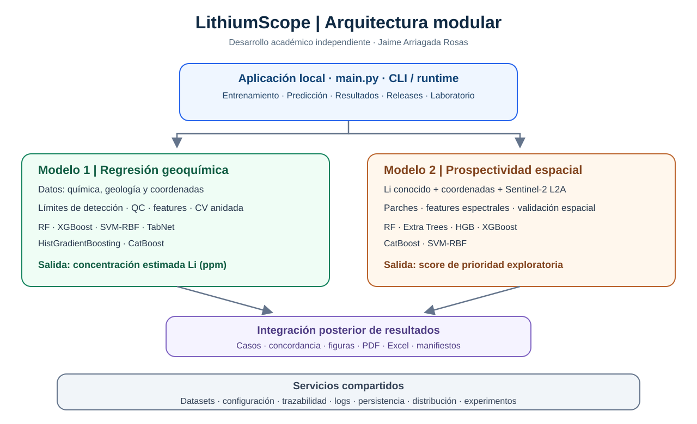

# Arquitectura de LithiumScope

**Estado:** descripción técnica del diseño actual del repositorio, 17 de noviembre de 2026. El software fue desarrollado íntegramente por **Jaime Arriagada Rosas**, independientemente de la memoria académica utilizada como referencia. Ver [autoría](../../CREDITS.md).

## Visión general

LithiumScope es una **aplicación de consola local, monolítica y modular** escrita en Python. No utiliza microservicios ni requiere un servidor propio para ejecutar el menú. El proyecto agrupa dos problemas científicos independientes, infraestructura común y herramientas experimentales:

- **M1:** predicción de concentración de litio en roca (regresión en ppm) utilizando datos geoquímicos/geológicos.
- **M2:** clasificación y prioridad exploratoria espacial a partir de características espectrales obtenidas con Sentinel-2 y etiquetas geoquímicas conocidas.
- **Integración:** combina resultados posteriores de M1 y M2 mediante casos/candidatos y genera evidencia; **no hay encadenamiento de la predicción M1 como feature del estimador M2**.

## Entrada y ejecución

- `main.py`: arranque desde un checkout; prepara la importación del paquete, configura matplotlib sin interfaz gráfica y comprueba dependencias de ejecución.
- `src/lithiumscope/runtime/`: preboot, ciclo de vida y cierre seguro.
- `src/lithiumscope/cli/menu.py`: despacha cinco acciones: entrenamiento, predicción, métricas/resultados, carga de modelos versionados y laboratorio.
- `src/lithiumscope/cli/*_command.py`: adapta entrada de consola a operaciones del dominio.
- `pyproject.toml`: metadatos, dependencias y entradas `lithiumscope` y `lithiumscope-inspect`.

## Componentes y límites

| Módulo | Responsabilidad principal |
|---|---|
| `cli/` | Interacción con el usuario, selección de flujos y presentación |
| `runtime/` | Inicialización, dependencias, reanudación de proceso y cierre |
| `core/` | Configuración, paths, logging, hashes, políticas de recursos y ejecución |
| `datasets/` | Adquisición, armonización, contratos, validación y manifests |
| `model_1/` | Pasos, selección de características, regresión, validación y evaluación de M1 |
| `model_2/` | Datos espectrales, metodología espacial, clasificación, validación y evaluación de M2 |
| `prediction/` | Predicción individual, integración de casos y generación de informes |
| `persistence/` | Modelos guardados, registro de candidatos y modelos activos |
| `results/` | Catálogo, consulta, exportación y preparación de candidatos a release |
| `distribution/` | Descarga, validación e instalación de bundles de GitHub Releases |
| `experiments/` | Simulaciones, auditorías y pruebas científicas fuera del flujo operativo principal |
| `tools/` | Diagnósticos e inspección reproducible de fuentes, entorno y pipeline |

**Regla de dependencia:** el menú no ejecuta preprocesamiento o cálculo científico; los algoritmos no necesitan conocer GitHub, archivos de presentación, el visor PDF ni las decisiones de interfaz. Las capas reutilizables no deben importar el menú.

## Flujo de datos

1. Adquirir o identificar datos, con manifest y verificación de procedencia.
2. Transformar y validar datos en pasos independientes.
3. Entrenar y evaluar familias de algoritmos utilizando el esquema de validación correspondiente.
4. Registrar métricas, OOF, configuración, versión, hashes, logs y selección.
5. Persistir modelos por `run_id` y, cuando procede, registrarlos como activos.
6. Realizar inferencia individual o integración de resultados, y generar PDF, Excel, CSV, figuras y evidencia.

M1 y M2 también pueden ejecutarse por separado; el flujo de entrenamiento **no es obligatorio** si se instala un release de modelos ya publicado.

## Experimentos frente a operación

`experiments/` y `scripts/scientific/` permiten investigar hipótesis, crear candidatos y estudiar robustez sin cambiar los modelos activos por defecto. Un ganador experimental no se convierte automáticamente en release ni garantiza validación externa. Los protocolos y limitaciones están en [pipelines científicos](SCIENTIFIC_PIPELINES.md), [documentación de modelos](../models/README.md) y [laboratorio](../scientific/README.md).

## Datos y artefactos

- `config/`: configuración de entrenamiento, datos y distribución.
- `data/raw/`, `data/interim/`, `data/processed/`: fuentes y etapas de procesamiento.
- `models/model_*/trained/`, `models/model_*/metadata/`: modelos y metadatos locales.
- `models/active_models.json`: selección activa local, no necesariamente equivalente al último release público.
- `results/model_*/runs/<run_id>/`: evidencias de cada entrenamiento.
- `results/predictions/`: predicción integrada/demostración y sus outputs.
- `results/scientific_simulations/`: campañas experimentales y evidencia de investigación.
- `logs/`: trazas de ejecución.

Gran parte de datos, pesos y cachés **no se versiona en Git**; los `.gitkeep` son solo placeholders. No confundir un clon limpio con un laboratorio completo. Ver [reproducibilidad](../operations/REPRODUCIBILITY.md) y [empaquetado](../operations/PACKAGING.md).

## Interfaces y pruebas

El proyecto mantiene contratos Python, configuración YAML, manifests JSON/CSV y artefactos por `run_id`. `tests/` contiene pruebas funcionales, científicas, de CLI, reportes, recuperación y releases. `.github/workflows/ci.yml` ejecuta Ruff, guardas de tamaño y pytest en Ubuntu y Windows con Python 3.11–3.13.

## Principios de implementación

La arquitectura es **modular y orientada a responsabilidades**, no una aplicación diseñada alrededor de una jerarquía de clases. Las ideas pertinentes de SOLID se aplican como buenas prácticas, junto a Clean Code, alta cohesión, bajo acoplamiento, funciones comprobables y reproducibilidad. Ver [principios de diseño](DESIGN_PRINCIPLES.md).

## Límites de alcance

Los scores y rankings espectrales de M2 son exploratorios: **no representan la probabilidad de descubrir un yacimiento rentable**. La integración de dos modelos no es validación externa; cualquier afirmación sobre generalización requiere el protocolo y evidencia adecuados.
