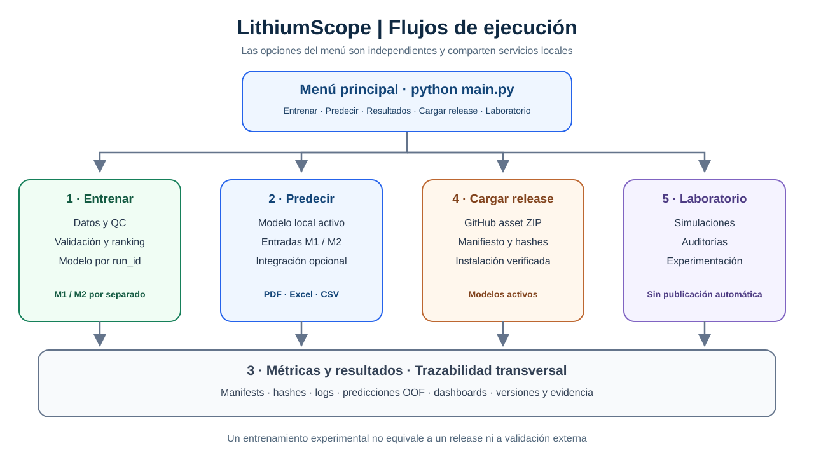
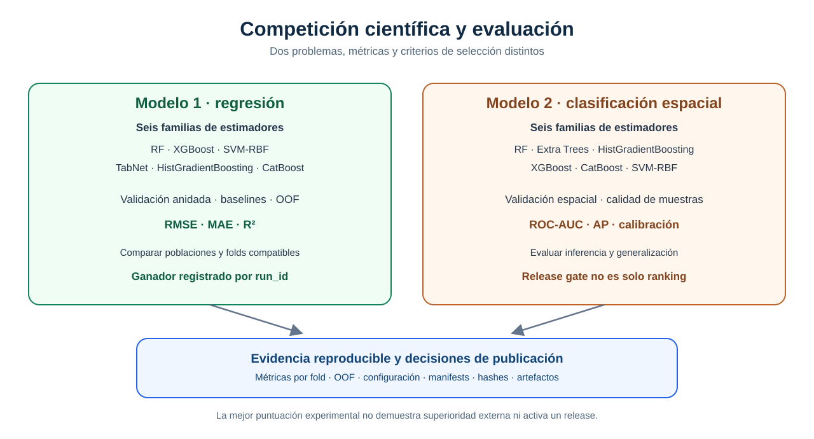

# Arquitectura de LithiumScope

LithiumScope es un **monolito modular local en Python**, implementado íntegramente por **Jaime Arriagada Rosas**. Su relación con OASIS y la memoria de referencia es exclusivamente académica y metodológica; consultar [autoría](../../CREDITS.md).

Este documento reúne la arquitectura de componentes, los dos pipelines científicos y los criterios de diseño que antes estaban repartidos en varios archivos. Para instalación y uso, comenzar por el [README principal](../../README.md).


## Entradas y responsabilidades

La aplicación no requiere un servidor propio ni microservicios. `main.py` inicia la ejecución desde el clon; `lithiumscope` es la entrada del paquete instalado; `lithiumscope-inspect` permite auditar el pipeline sin iniciar entrenamiento. El menú debe ser un despachador y delegar en comandos y servicios.

| Directorio | Responsabilidad |
|---|---|
| `src/lithiumscope/cli/` | Menús, selección de operaciones y comandos |
| `runtime/` | Preboot, control de dependencias, ciclo de vida y cierre seguro |
| `core/` | Configuración, paths, recursos CPU/GPU, logs, tracking y controles compartidos |
| `datasets/` | Adquisición, contratos, armonización y manifiestos |
| `model_1/` | Preparación, entrenamiento, validación, evaluación y predicción geoquímica |
| `model_2/` | Parches Sentinel-2, features, validación espacial y clasificación |
| `prediction/` | Inferencia individual, combinación posterior y reportes PDF/Excel |
| `persistence/` | Persistencia, metadatos y modelos activos |
| `results/` | Catálogo de resultados, dashboards y candidatos a versión |
| `distribution/` | Consulta, descarga y validación de paquetes de modelos |
| `experiments/` | Estudios y campañas científicos independientes |
| `tools/` | Inspector y diagnósticos del entorno y de fuentes |

**Límite de dependencia:** el menú no implementa algoritmos; el cálculo científico no depende de la interfaz, de GitHub ni del generador de PDF. Las operaciones de infraestructura se comparten sin acoplar M1 y M2.



## Pipeline M1: predicción geoquímica

**Entrada:** propiedades geoquímicas/geológicas de muestras de roca. **Salida:** concentración estimada `Li_icpms` (ppm).

La secuencia conceptual es:

1. **Carga:** CSV/XLS/XLSX y normalización de codificaciones.
2. **Límites de detección:** conversión y auditoría de valores censurados.
3. **Faltantes:** diagnóstico y tratamiento sin introducir información del fold de prueba.
4. **Filtro del objetivo:** verificar disponibilidad y calidad del Li medido.
5. **Control geoquímico:** reglas de calidad y coherencia composicional.
6. **Categorías:** codificación de variables geológicas y textuales.
7. **Ingeniería de variables:** derivados geoquímicos según el contrato de datos.
8. **Preprocesamiento:** ajuste dentro de particiones adecuadas para evitar leakage.
9. **Entrenamiento y validación:** competencia, nested CV, OOF y estimador ganador.

Los seis candidatos son Random Forest, XGBoost, SVM-RBF, TabNet, HistGradientBoosting y CatBoost. Las métricas relevantes son **RMSE, MAE y R²**; DummyRegressor proporciona referencia sin competir como modelo final. Una comparación justa exige considerar las mismas observaciones y protocolos de validación.

El código reside en `model_1/preparation/`, `eda/`, `training/`, `validation/`, `evaluation/`, `diagnostics/`, `methodology/` y `prediction/`. `pipeline.py` coordina la ejecución sin reexportar las funciones de preparación. Los consumidores importan directamente del propietario de cada responsabilidad. La compatibilidad con clases serializadas históricas se limita al deserializador de persistencia; no se mantienen módulos puente de `steps/`. La fuente, unidades, variables y recortes están detallados en [datasets](../data/DATASETS_AND_FEATURES.md) y [contratos](../data/INPUT_OUTPUT_VARIABLES.md).

## Pipeline M2: clasificación y prioridad espacial

**Entrada:** muestras con Li conocido y coordenadas asociadas a parches multibanda Sentinel-2 L2A. **Salida:** score de prioridad exploratoria, sin implicar certeza geológica o económica.

Flujo conceptual:

```text
Li conocido + coordenadas
    -> asociación muestra/escena Sentinel-2
    -> extracción y cache del parche
    -> características espectrales y etiquetas
    -> validación espacial agrupada
    -> comparación, calibración y selección
    -> modelo persistido -> score de inferencia
```

Compiten Random Forest, Extra Trees, HistGradientBoosting, XGBoost, CatBoost y SVM-RBF. La evaluación incluye ROC-AUC, Average Precision, Brier y estudios de calibración. Los cuantiles y umbrales derivados del entrenamiento no pueden ajustarse utilizando el test que se pretende evaluar.

**Esquemas de entrada:** el M2 histórico publicado trabaja con **126 características** y el candidato espectral v4 investiga **170**. Esta diferencia no es decorativa: cargar un modelo con features incompatibles y rellenarlas con valores artificiales puede invalidar la predicción. El candidato de investigación no sustituye al release antes de verificar inferencia y superioridad bajo protocolos comparables.

Los grupos espaciales y la procedencia de etiquetas son parte del diseño de evaluación. Una simulación estable, un mayor AUC en otra población o un piloto GEOROC no equivalen a validación externa certificada. Ver [metodología M2](../models/MODEL_2_METHODOLOGY.md), [versiones](../models/VERSIONING.md) y [evidencia científica](../scientific/georoc/GEOCHEMICAL_EVIDENCE_SOURCES.md).

## Integración y resultados

M1 y M2 pueden entrenarse, evaluarse e inferirse de forma **independiente**. La predicción integrada relaciona casos y resultados a posteriori. **El score calculado por M1 no se usa como entrada del estimador M2** en este flujo.

La demostración automática de diez casos se ejecuta desde el menú de predicción y produce evidencia mediante los módulos originales del software: PDF, Excel, CSV, figuras, diagnósticos y manifiesto de la ejecución. No genera otra familia de modelos ni prueba por sí sola la validez externa.



## Infraestructura, identidad y distribución

- `config/` guarda configuración YAML/JSON del checkout; el wheel incluye defaults generados desde esos archivos.
- `data/raw/`, `data/interim/` y `data/processed/` guardan entradas y productos intermedios locales.
- `models/model_*/trained/` conserva modelos identificados por `run_id`; `models/active_models.json` identifica la selección activa del equipo.
- `results/model_*/runs/` conserva métricas, OOF, figuras, datasets hashes y manifests.
- `results/predictions/` y `results/scientific_simulations/` contienen predicciones y campañas científicas.
- `logs/` registra ejecución, entrenamiento, predicción y errores.
- `distribution/` instala los assets de GitHub Releases mediante comprobaciones de manifiestos, rutas ZIP, hashes y compatibilidad de los modelos.

Los modelos activos locales **no tienen por qué coincidir** con el release público más reciente. La selección de un nuevo ganador no crea automáticamente un tag. Consultar [reproducibilidad](../operations/REPRODUCIBILITY.md), [empaquetado](../operations/PACKAGING.md) y [modelos publicados](../models/MODEL_RELEASES.md).

## Criterios de diseño: Clean Code, modularidad y SOLID

La arquitectura se basa en **alta cohesión, bajo acoplamiento, funciones comprobables, contratos explícitos y reproducibilidad**. Se aplican ideas de SOLID donde aportan valor, sin describir todo el sistema Python como orientación a objetos ni afirmar que superar un test demuestra SOLID.

| Idea | Aplicación concreta |
|---|---|
| Responsabilidad única (S) | `steps/` transforma, `pipeline.py` coordina, la CLI despacha y los reportes presentan |
| Extensión sin rehacer pipelines (O) | `factory.py` registra algoritmos y el runner emplea contratos comunes |
| Sustitución cuando aplica (L) | Los estimadores respetan `fit/predict` o `fit/predict_proba` según la tarea |
| Interfaces separadas (I) | M1 usa regresión, M2 clasificación; no se fuerza un contrato mezclado |
| Inversión de dependencias cuando aplica (D) | El runner y los orquestadores emplean interfaces/adaptadores en vez de fijar un algoritmo |

Estas son **pautas de diseño**, no una certificación formal de los cinco principios. Además:

- El preprocesamiento y ajuste de hiperparámetros deben respetar las particiones de validación.
- Semillas, fingerprints científicos, commits, dataset hashes, esquemas de features y `run_id` deben permitir auditar una ejecución.
- Ninguna mejora visual o documental debería sobrescribir la evidencia de un entrenamiento histórico.
- `tests/core/test_architecture.py` y `scripts/check_code_size.py` protegen algunas decisiones estructurales, **no definen la calidad de una arquitectura por su número de líneas**.
- El laboratorio de inspección separa adquisición, HTTP, parsing, verificación de datos, reportes y diagnóstico de GPU. No debe concentrar esas funciones en el menú.

## Pruebas y limitaciones

Los tests y el pipeline de integración continua verifican contratos, regresiones, compatibilidad de plataforma y propiedades científicas implementadas. Se prueban Python 3.11–3.13, Windows y Ubuntu; la batería automatizada no sustituye una auditoría científica independiente.

**Límites de interpretación:** M1 puede extrapolar fuera del dominio de entrenamiento; M2 estima prioridad exploratoria, no depósitos certificados. El entrenamiento sobre fuentes heterogéneas, firmas espectrales redundantes y cercanía espacial entre muestras requieren protocolos explícitos. Las bitácoras históricas se mantienen en `docs/models/` y `docs/scientific/` con su fecha y contexto, sin reescritura retrospectiva.
